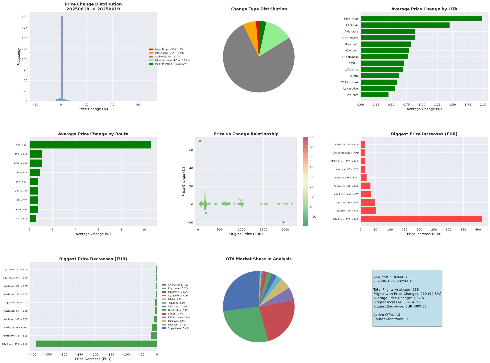
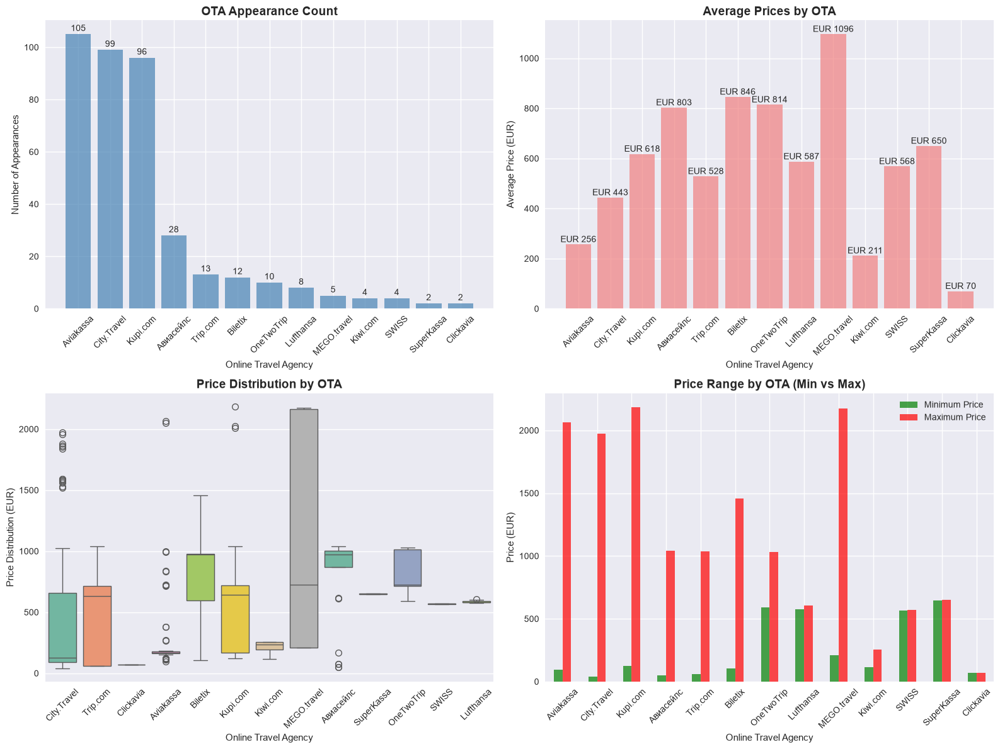
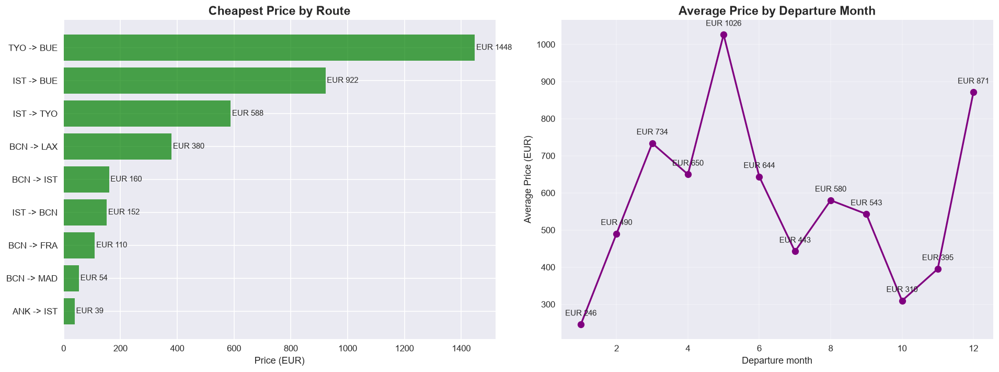

# Flight Price Monitoring

A small project that collects daily snapshots of flight prices for a fixed set of routes from the Travelpayouts (Aviasales) API and compares them over time. Each run of the fetch script saves one snapshot. A comparison script matches offers between two snapshots and reports how prices changed per route and per online travel agency (OTA), and a DuckDB notebook does the exploratory analysis on top of the snapshots.

## Data source

Prices come from the Travelpayouts Data API endpoint `v2/prices/latest`. This endpoint returns cached prices that Aviasales users found recently, not live fares, so each snapshot is what the API had cached on that day. For each route the script asks for up to 30 offers in EUR, sorted by price. The OTA selling the ticket is in the `gate` column.

Routes requested (`ROUTES` in `fetch_prices.py`):

| Origin | Destination |
|---|---|
| BCN Barcelona | MAD Madrid |
| BCN Barcelona | FRA Frankfurt |
| IST Istanbul | BCN Barcelona |
| BCN Barcelona | IST Istanbul |
| ESB Ankara | IST Istanbul |
| IST Istanbul | NRT Tokyo |
| BCN Barcelona | LAX Los Angeles |
| IST Istanbul | EZE Buenos Aires |
| ESB Ankara | LAX Los Angeles |
| NRT Tokyo | EZE Buenos Aires |

The API answers with city codes, so ESB shows up as ANK, NRT as TYO and EZE as BUE in the data. ESB -> LAX returned no offers in either snapshot.

Two snapshots are included: `snapshots/20250618` and `snapshots/20250619`.

## Approach

1. `fetch_prices.py` calls the API for every route and writes `snapshots/YYYYMMDD/all_routes.csv`, one CSV per route under `route_breakdown/`, and a `snapshot_summary.json`.
2. `price_comparison_analysis.py` loads two snapshots and inner-joins them on origin, destination, departure date and OTA. For every matched offer it computes the absolute and percentage price change, buckets the change (major/minor drop, stable within 1%, minor/major increase) and aggregates by OTA and by route. It writes CSVs and a 3x3 chart grid to `analysis_results/`.
3. `flight_analysis_duckdb.ipynb` registers the combined snapshots as a DuckDB table and uses SQL for OTA share and price levels, route price ranges, price spread per route, monthly averages by departure month, and a look at the comparison results. Charts are made with matplotlib and seaborn.

## Results (18 vs 19 June 2025)

From the notebook and comparison outputs:

- 195 offers on the first day and 193 on the second, 388 in total, from 13 OTAs across 9 routes.
- Aviakassa (27.1%), City.Travel (25.5%) and Kupi.com (24.7%) supplied most of the offers.
- Average offer price went from EUR 496.85 to EUR 495.24 (-0.32%).
- 236 offers could be matched across both days and 219 of them changed price. The mean change was +1.07% with a standard deviation of 5.34%. 8 offers rose by more than 5% and 3 fell by more than 5%.
- The largest single moves were both on TYO -> BUE at City.Travel: +413 EUR and -389 EUR.
- The cheapest route was ANK -> IST (from EUR 39), the most expensive TYO -> BUE (average EUR 1,802.96).

With only two days of data these numbers mostly show day-to-day noise, not trends.

## Figures

Comparison of the two snapshots from `price_comparison_analysis.py` (offers matched on route, departure date and OTA):



Offer count and price level per OTA, from the DuckDB notebook:



Cheapest offer per route and average price by departure month, from the DuckDB notebook:



## How to run

```bash
pip install -r requirements.txt
```

Create a `.env` file next to `fetch_prices.py` with your Travelpayouts API token:

```
TRAVELPAYOUTS_TOKEN=your_token_here
```

Then:

```bash
# take a snapshot for today (writes snapshots/YYYYMMDD/)
python fetch_prices.py

# compare two snapshots (writes to analysis_results/)
python price_comparison_analysis.py --date1 20250618 --date2 20250619

# exploratory analysis
jupyter notebook flight_analysis_duckdb.ipynb
```

`price_comparison_analysis.py` also accepts `--snapshots-dir` if the snapshots live somewhere else. For a longer time series, schedule `fetch_prices.py` once a day (cron, Task Scheduler); each day goes into its own folder.

## Repository layout

```
fetch_prices.py                 # collects one snapshot from the API
price_comparison_analysis.py    # compares two snapshots, writes CSVs and a chart
flight_analysis_duckdb.ipynb    # DuckDB / SQL exploratory analysis
requirements.txt
snapshots/
  20250618/
    all_routes.csv
    route_breakdown/            # one CSV per route
  20250619/
    all_routes.csv
    route_breakdown/
    snapshot_summary.json
analysis_results/               # comparison output for 20250618 vs 20250619
docs/images/                    # figures used in this README
```

## License

MIT, see `LICENSE`.
